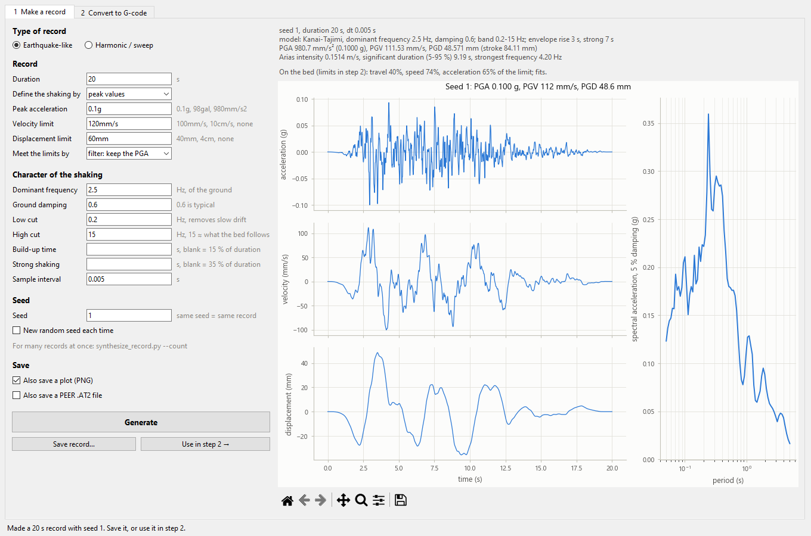
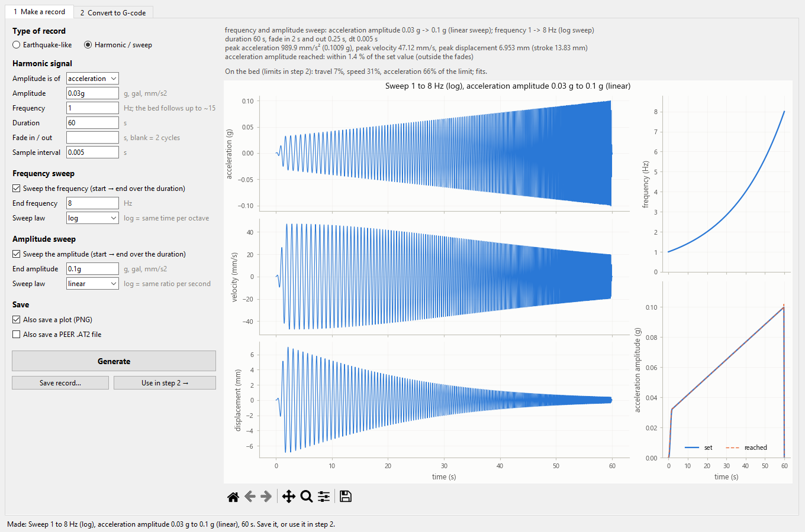
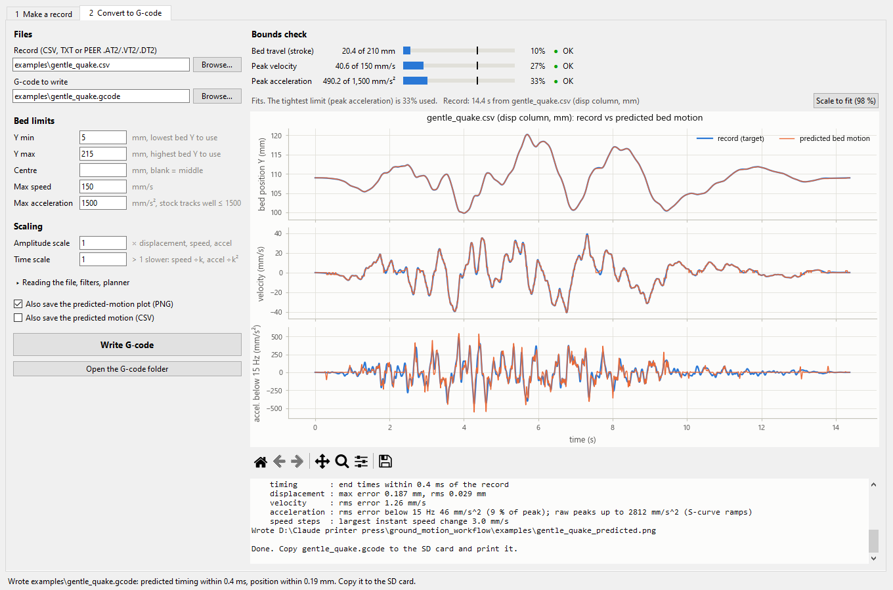

# 3D printer to shake table conversion scripts

### Synthetic ground motion generator

Turn the bed of a **Creality Ender 3 S1 Pro** into a small one-axis shake table. Generate
earthquake-like records, sines and sweeps (or load real earthquake records), check them against
what the bed can do, and write G-code that you print from the SD card like any other file.

by **RomanJasen**\*



- **Earthquake-like records:** a standard stochastic model (Kanai-Tajimi filtered noise with a
  build-up / strong / decay envelope). You choose the length, peak acceleration and the
  velocity/displacement limits.
- **Harmonic records:** sines, frequency sweeps and amplitude sweeps. The amplitude is defined in
  displacement, velocity or acceleration.
- **Real records:** PEER `.AT2/.VT2/.DT2` files and CSV/TXT tables.
- **Bounds check and scaling:** compares stroke, peak velocity and peak acceleration with the bed's
  limits, and shrinks the record to fit if you ask.
- **G-code that keeps the record's timing:** a model of the printer firmware's motion planner
  chooses each move's speed so the bed stays on time. The tool reports how closely the bed is
  predicted to follow.
- A **window (GUI)** for all of it, and command-line scripts for batches.

## Quick start

1. **Download.** On this page, press the green **Code** button, then **Download ZIP**, and unzip it.
   (Or `git clone` the repository.)
2. **Install Python 3** from [python.org](https://www.python.org/downloads/). On Windows, tick
   *"Add python.exe to PATH"* in the installer.
3. **Install the two libraries it needs:** open a terminal in the unzipped folder and run
   ```bash
   pip install -r requirements.txt
   ```
4. **Open the window:** on Windows, double-click **`Shake table GUI.bat`**. Anywhere else, run
   `python shake_gui.py`.
5. **First run on the printer:** copy `examples/sine_2Hz_5mm_20s.gcode` to the SD card and print it.
   This is a gentle 2 Hz, ±5 mm sine.

## The printer setup

- **Tested on:** an Ender 3 S1 Pro with **stock Creality firmware**, with the print head removed.
  The **Y axis (the bed)** is the shaking table.
- **Bed limits:** the defaults allow bed positions Y 5–215 mm, 150 mm/s and 1500 mm/s² (0.15 g).
  If you modified the frame, set the travel to what your machine really allows.
- **Settings are temporary:** the G-code changes the firmware's speed, acceleration and jerk
  settings in RAM only. It puts the stock values back at the end, and nothing is saved to EEPROM.
- **Homing:** it homes **Y only** (`G28 Y R0`), so nothing else on the printer moves.
- **Other printers:** the printer and firmware data are in a profile in `shake_engine.py`. A
  Klipper profile is included but **untested**.

> ⚠️ **Safety.** Use at your own risk. Fix the payload firmly to the bed, keep hands clear of the
> moving bed, and keep a hand near the power switch the first time you run a new file.
> If the bed ends somewhere other than where it started, it lost steps: lower the amplitude or
> the payload mass, or lower `--planner-accel-max`.

## Files

| File | What it is |
|---|---|
| `Shake table GUI.bat` | Double-click to open the window (Windows) |
| `shake_gui.py` | The window: both steps, with plots |
| `synthesize_record.py` | Step 1 on the command line: synthetic earthquake-like records |
| `harmonic_record.py` | Step 1 on the command line: sines, frequency sweeps and amplitude sweeps |
| `record_to_gcode.py` | Step 2 on the command line: checks a record against the bed, scales it if asked, writes G-code |
| `shake_engine.py` | Used by step 2: the firmware planner model and the G-code writer |
| `examples/` | Example records (`.csv`), their G-code (`.gcode`), and plots of both |
| `docs/` | Screenshots for this page |

The window saves to `records/` and `gcode/`; these folders are created when needed.

```
synthesize_record.py (earthquake-like) ─┐
harmonic_record.py (sines, sweeps)  ────┼─►  records/*.csv  ──►  record_to_gcode.py  ──►  gcode/*.gcode  ──►  SD card
a real record (PEER .AT2, any CSV)  ────┘                        checks the bed limits, scales to fit
```

### Examples

| Example | What it is | Stroke | Peak accel. |
|---|---|---|---|
| `sine_2Hz_5mm_20s` | 2 Hz sine, ±5 mm, 20 s: **run this first** | 10 mm | 0.08 g |
| `gentle_quake` | Synthetic earthquake, 0.05 g, 15 s | 20 mm | 0.05 g |
| `sweep_1-6Hz_0.03g_60s` | Log sweep 1 → 6 Hz at a constant 0.03 g, 60 s | 13 mm | 0.03 g |

Each example has the record (`.csv`, plotted in `.png`) and the G-code (`.gcode`). The
`_predicted.png` plot shows the predicted bed motion over the record.

## The window (GUI)

The window and the scripts run the same code, so they make the same files.

**Tab 1, Make a record.** Choose the *Type of record* at the top. Units can be typed with the
value: `0.1g`, `100mm/s`, `4cm`, `none`.
- **Earthquake-like:** same settings as `synthesize_record.py`. **Generate** draws the record and
  its response spectrum. With *New random seed each time* off, the seed shown is reused, so you can
  change one setting and compare.
- **Harmonic / sweep:** same settings as `harmonic_record.py`.
  - Choose whether the amplitude is for displacement, velocity or acceleration.
  - Tick *Sweep the frequency* and/or *Sweep the amplitude* to sweep from the start value to the end
    value.
  - The plot shows the time histories, the frequency over time, and the amplitude set vs reached.
- The line above the plot says how much of the bed's limits the record uses (the limits set in
  tab 2).
- **Save record…** writes the CSV (plus PNG / .AT2 if ticked).
- **Use in step 2 →** saves the record and opens it in tab 2. For a harmonic record it also sets
  Low-pass to 0 (off), since a sine has nothing to filter; for an earthquake record it sets 15 Hz.
  The log in tab 2 says when it changed this.
- Each type keeps its own last record, so you can switch back and forth.



**Tab 2, Convert to G-code.** Pick a record (*Browse…*). It is checked as soon as anything changes:
- The bars show stroke, peak velocity and peak acceleration against the limits. The black tick is
  100 %, and a red bar means *too big*.
- The plot shows the bed's position, velocity and acceleration, with dashed lines where they come
  near a limit.
- **Scale to fit (98 %)** sets the amplitude so the tightest limit is 98 % used (it also scales up
  a small record).
- **Write G-code** plans the moves (a few seconds; about 4 s for a 300 s record), then shows the
  predicted bed motion over the record and the full report. If the record doesn't fit, it offers to
  scale it first.
- *Reading the file, filters, planner* opens the less-used settings: column, units, sample interval,
  trimming, filters and the planner acceleration cap.



## Step 1, earthquake-like: synthesize a record

```bash
python synthesize_record.py --duration 20 --pga 0.1g -o records/my_quake.csv --plot
python synthesize_record.py --duration 30 --pga 0.12g --pgv-max 100mm/s --pgd-max 40mm --count 5 -o records/set.csv
```

| Setting | Meaning | Default |
|---|---|---|
| `--duration` | Record length, s | 20 |
| `--pga` | Peak acceleration the record reaches | 0.1g |
| `--pgv-max` | Upper limit for peak velocity (`none` = no limit) | 120mm/s |
| `--pgd-max` | Upper limit for peak displacement (`none` = no limit) | 60mm |
| `--limit-mode` | How to meet the PGV/PGD limits. `filter` raises the high-pass corner, removing slow drift while keeping the PGA. `scale` shrinks the whole record and keeps its frequency content. | filter |
| `--f-dominant`, `--damping` | Ground (soil) frequency and damping of the Kanai-Tajimi filter. Higher frequency means stiffer ground and more rapid shaking. | 2.5 Hz, 0.6 |
| `--f-low`, `--f-high` | Frequency band. 15 Hz is about the highest the bed can follow. | 0.2, 15 Hz |
| `--rise`, `--strong` | Envelope: build-up time and strong-shaking time; the rest decays | 15 %, 35 % of the duration |
| `--seed` | Same seed gives the same record. Without it a random seed is used and written in the file. | random |
| `--count` | Several different records (`_01`, `_02`, …) | 1 |
| `--plot`, `--at2` | Also write a PNG (time histories + 5 % response spectrum) or a PEER `.AT2` file | off |

Units can be written with the value: `0.1g`, `980mm/s2`, `0.98m/s2`, `98gal` | `100mm/s`, `10cm/s` | `40mm`, `4cm`.
Bare numbers mean mm, mm/s, mm/s².

How a record is made (a standard stochastic ground-motion model):
1. Random white noise is shaped by a soil filter (Kanai-Tajimi).
2. It is multiplied by an envelope: build-up, strong shaking, decay.
3. It is band-limited and integrated to displacement.
4. The displacement is faded to rest at both ends. Velocity and acceleration are its exact derivatives, so all three start and end at zero.
5. The record is scaled to the PGA.

The CSV holds `time_s, accel_mm_s2, vel_mm_s, disp_mm`. Its header records the seed, the settings, and the PGA, PGV, PGD, Arias intensity and significant duration.

## Step 1, harmonic: sines and sweeps

```bash
python harmonic_record.py --define disp --amplitude 5mm --freq 2 --duration 20 --plot
python harmonic_record.py --define accel --amplitude 0.05g --freq 1 --freq-end 8 --duration 60 --plot
python harmonic_record.py --define vel --amplitude 20mm/s --amplitude-end 80mm/s --freq 3 --duration 30
python harmonic_record.py --define accel --amplitude 0.02g --amplitude-end 0.1g --freq 1 --freq-end 8 --duration 60
```

Without `-o` the file goes to `records/` with a descriptive name, such as `sweep_1-8Hz_0.05g_60s.csv`.

| Setting | Meaning | Default |
|---|---|---|
| `--define` | Which quantity the amplitude is for: `disp`, `vel` or `accel` | disp |
| `--amplitude` | Amplitude of that quantity (half the peak-to-peak) | 5mm / 30mm/s / 0.05g |
| `--freq` | Frequency (the start frequency of a sweep), Hz | 2 |
| `--duration` | Length, s | 20 |
| `--ramp` | Fade-in and fade-out time, s, so the bed starts and ends at rest | 2 cycles (≤ 20 % of duration) |
| `--freq-end` | Sweep the frequency to this, Hz | no sweep |
| `--freq-law` | `log`: the same time for every octave (the usual shake-table sweep). `linear`: constant Hz per second | log |
| `--amplitude-end` | Sweep the amplitude to this (same quantity) | no sweep |
| `--amplitude-law` | `linear`, or `log`: the same ratio every second | linear |
| `--dt`, `--plot`, `--at2` | Sample interval, PNG, PEER .AT2, as for earthquake records | 0.005 s, off, off |

Both sweeps run over the whole duration, and they can be combined.

**What the amplitude choice means:**
- **Displacement:** a sweep at constant displacement gets much faster and harder as the frequency
  rises.
- **Velocity:** constant speed amplitude.
- **Acceleration:** the usual shake-table test, constant g. The displacement is then large at low
  frequency, A/(2πf)².

So a constant-acceleration sweep is limited by the travel at its low end, while a
constant-displacement sweep is limited by speed and acceleration at its high end. The bed line in
the window and step 2's bounds check show this.

**How it is built:**
- The displacement is made directly: a smooth fade times the amplitude converted to displacement
  (A, A/ω or A/ω²), times the sine.
- Velocity and acceleration are its exact derivatives, so the three always agree, nothing drifts,
  and all three start and end at zero.
- In a sweep, the amplitude of the chosen quantity comes out within a few per cent of the set
  value. The file header says how close it came (0.1–1.4 % in tests).

**Above about 8 Hz:** step 2's default 15 Hz low-pass starts to trim a sine's amplitude (2 % at
10 Hz, 8 % at 12 Hz). Convert with `--lowpass 0`; the window does this for you. Above about 15 Hz
the bed can't follow anyway: at 1500 mm/s² the stroke is under 0.4 mm.

**What to expect from steady 0.1 g sines** (predicted by the firmware model, steady middle part):

| Frequency | Displacement amplitude played | Displacement amplitude |
|---|---|---|
| 1–4 Hz | within 0.5 % | 23 to 1.5 mm |
| 5–6 Hz | 2 % low | 1.0 to 0.7 mm |
| 8 Hz | 7 % low | 0.4 mm |
| 10–12 Hz | 10–14 % low | 0.25 to 0.17 mm |

- The stock firmware also delivers part of each speed change as small instant steps (its "jerk",
  up to about 3–4 mm/s). They show up as ripple on a measured acceleration trace, more so at small
  amplitudes.
- Moves shorter than about 0.1 mm (6 motor steps) are ignored by the firmware. The generator warns
  when a record's displacement gets that small, and step 2 refuses a record that is too small
  overall.

## Step 2: convert to G-code

```bash
python record_to_gcode.py records/my_quake.csv -o gcode/my_quake.gcode --plot
python record_to_gcode.py records/big_quake.csv --fit -o gcode/big_quake.gcode     # shrink to fit
python record_to_gcode.py RSN1234_NORTHR.AT2 --fit -o gcode/northridge.gcode        # real record
```

It prints a bounds check first:

```
                                record         limit    used
  bed travel (stroke)       159.4 mm        210 mm       76%  OK
  peak velocity             266.0 mm/s      150 mm/s    177%  TOO BIG
  peak acceleration        2448.7 mm/s^2   1500 mm/s^2  163%  TOO BIG
```

- **Everything fits:** it writes the G-code.
- **Something is too big:** it stops and says by how much. Then:
  - `--fit` shrinks the amplitude to 98 % of the tightest limit (here ×0.553, set by peak velocity).
  - `--scale 0.5` sets your own factor.
  - `--time-scale 2` plays it at half speed: speed drops ×2, acceleration ×4, and the stroke stays the same. This is useful for scaled models.
- **Bed limits:** `--y-min/--y-max` (default 5–215 mm of bed Y), `--max-vel` (150 mm/s), `--max-accel` (1500 mm/s²).
  **Set the travel to what your machine actually allows.**
- **Inputs:** CSVs from step 1 are read automatically, using the displacement column (exact, nothing to integrate).
  For other files use `--type accel|vel|disp --units … --column N`. PEER `.AT2/.VT2/.DT2` files work directly.
  Integrating acceleration applies a 0.2 Hz high-pass (`--highpass`). That's right for real records, but it trims some displacement from a record that was already filtered.

It then reports how closely the bed is predicted to follow, and `--plot` draws it
(`<name>_predicted.png`). Typical for a 0.1 g record: timing within 0.5 ms, displacement within
0.3 mm, acceleration error 6-10 % below 15 Hz.

## What the G-code does on the printer

1. Sets the firmware's speed, acceleration and jerk limits for the run. These are RAM only and restored at the end.
2. Turns bed levelling off and homes **Y only** (`G28 Y R0`: no Z raise, no probe).
3. Moves to the start position, pauses 3 s, and plays the record.
4. Parks in the middle of the range and restores the stock settings.

## How it works

Printer firmware only understands straight moves at a set speed (`G1 Y.. F..`). Its planner adds
its own acceleration ramps, so a record played back naively falls behind. `shake_engine.py` works
around this:
1. It cuts the record into short moves, split at every reversal.
2. It runs a model of the stock firmware's planner, including its jerk handling, S-curve ramps,
   8-move buffer, minimum step rate and minimum move length.
3. It adjusts each move's speed until every move ends when the record says it should.

The values come from Creality's published Ender-3 S1 firmware configuration.

## Notes

- All accuracy figures are **predictions** from that model. A 2 Hz sine played on a real
  Ender 3 S1 Pro behaved as predicted. To measure what really happens, tape a phone running
  [phyphox](https://phyphox.org/) ("Acceleration without g") to the bed.
- Above about 1500 mm/s² (0.15 g) the stock firmware follows less closely. The converter warns you.
- If the bed loses steps (it ends somewhere other than where it started), lower `--planner-accel-max` (e.g. 2500), the amplitude, or the payload mass.

## License

MIT. See [LICENSE](LICENSE). You may use, change and share it; keep the copyright notice.

---

\* *Made with assistance from Claude Opus 5.5 (Anthropic).*
